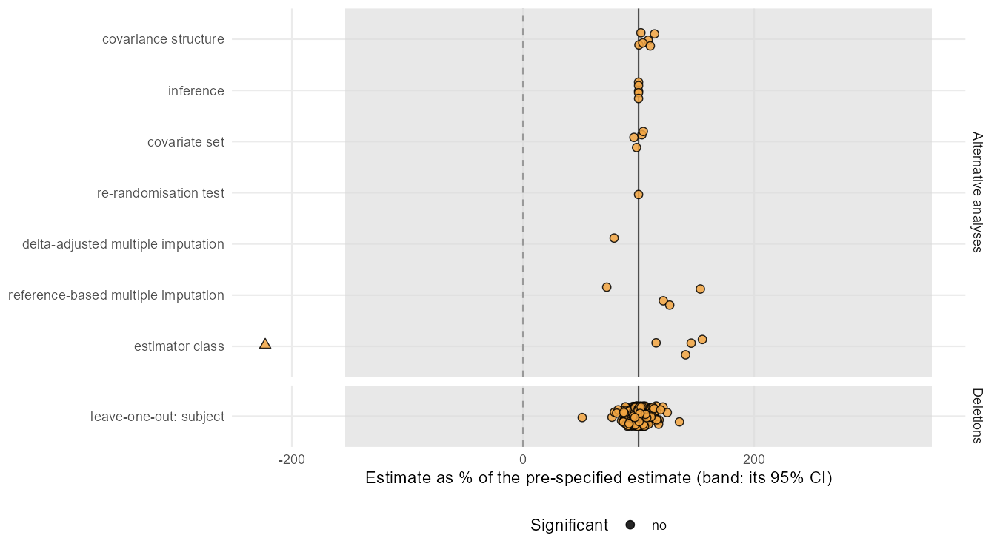
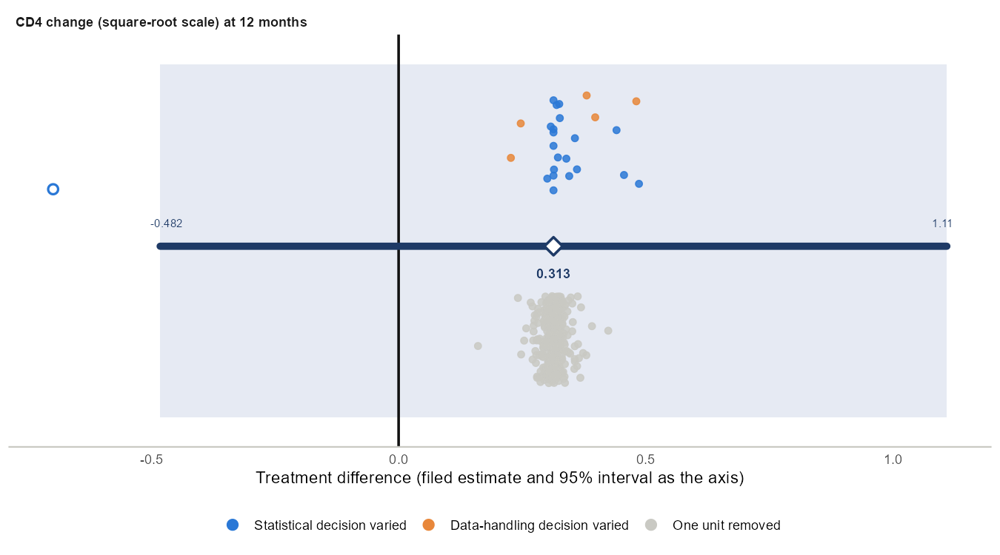
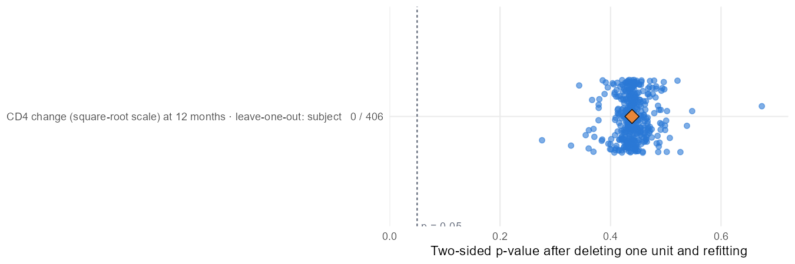
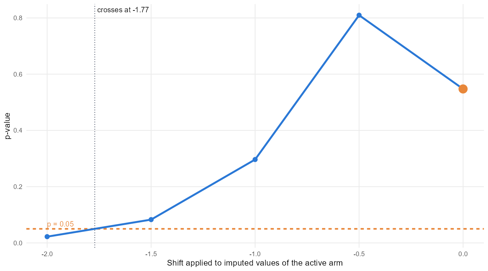

# Standard stress test (ballast 0.7.3)

Generated 2026-10-28 10:53 with ballast 0.7.3.

## Plan

    Standard stress test (ballast 0.7.3)
    
    Pre-specified analysis: change ~ cd4_base + prevOI + AZT + drug + visit + drug:visit + us(visit | patient); contrast ddI minus ddC at 12; Satterthwaite df, Asymptotic variance; alpha 0.05; equal LS-mean weights.
    
    Perturbation families, run after unblinding exactly as listed; every refit is judged against the pre-specified estimate,
    its 95% confidence interval and alpha.
    Classification: fragile if any counted alternative lands outside the pre-specified 95% confidence interval; otherwise sensitive if any crosses alpha; otherwise robust.
    Specifications reached by two families are counted once; tipping-point grids are searches and are not counted; deletions are
    counted separately.
    
    1. Within-subject covariance structure: structures = us, ar1h, ar1, cs, csh, toep, toeph
    2. Degrees-of-freedom method and variance estimator: defaults
    3. Covariate set: defaults
    4. Least-squares-mean weighting (equal versus observed margins): defaults
    5. Leave-one-out deletions: defaults
    6. Re-randomisation test: n = 2000
    7. Delta-adjusted multiple imputation (tipping point): deltas = 0, -0.5, -1, -1.5, -2; m = 25; shift_visits = 12
    8. Reference-based multiple imputation (MAR, J2R, CR, CIR): m = 25
    9. Estimator class: estimators = complete_cases, gee_independence, ancova, robust_ancova, clda; baseline = cd4_base; diagnostic = complete_cases. The complete cases refit is fitted, drawn and tabulated as a diagnostic and is not counted.
    10. Smallest set of subjects that changes the conclusion: target = significance; max_k = 5

## Pre-specified analysis

Estimate 0.3134 (SE 0.404), 95% CI -0.4825 to 1.109, p = 0.439; 406 subjects, 938 observations.

## Verdict

**ROBUST** over all 431 counted rows; **ROBUST** over the 431 sensitivity analyses (same estimand).
0 significant, 0 crossed alpha, 0 outside the pre-specified CI, 0 reversed direction; largest shift 0.428 pre-specified SEs. 1 diagnostic refit was fitted and shown (counted = FALSE in the family table) and not counted.

Smallest subject set that changes significance: not found within 5 removals (174, 50, 377, 68, 455).

## Summary by family

| family | kind | n | significant | crossed | outside_ci | reversed | pct_min | pct_max | max_shift_se | counted | role |
| --- | --- | --- | --- | --- | --- | --- | --- | --- | --- | --- | --- |
| covariance structure | alternative | 6 | 0 | 0 | 0 | 0 | 100.303 | 113.822 | 0.107 | TRUE | sensitivity |
| inference | alternative | 5 | 0 | 0 | 0 | 0 | 100.000 | 100.000 | 0.000 | TRUE | sensitivity |
| covariate set | alternative | 4 | 0 | 0 | 0 | 0 | 95.994 | 104.084 | 0.032 | TRUE | sensitivity |
| leave-one-out: subject | deletion | 406 | 0 | 0 | 0 | 0 | 51.241 | 135.358 | 0.378 | TRUE | sensitivity |
| re-randomisation test | alternative | 1 | 0 | 0 | 0 | 0 | 100.000 | 100.000 | 0.000 | TRUE | sensitivity |
| delta-adjusted multiple imputation | alternative | 1 | 0 | 0 | 0 | 0 | 78.854 | 78.854 | 0.164 | TRUE | sensitivity |
| reference-based multiple imputation | alternative | 4 | 0 | 0 | 0 | 0 | 72.483 | 153.465 | 0.414 | TRUE | sensitivity |
| estimator class | alternative | 4 | 0 | 0 | 0 | 0 | 115.161 | 155.183 | 0.428 | TRUE | sensitivity |
| estimator class | diagnostic | 1 | 0 | 0 | 1 | 1 | -223.038 | -223.038 | 2.504 | FALSE | sensitivity |
| All sensitivity | all | 431 | 0 | 0 | 0 | 0 | 51.241 | 155.183 | 0.428 | TRUE | sensitivity |
| All | all | 431 | 0 | 0 | 0 | 0 | 51.241 | 155.183 | 0.428 | TRUE | all |

## Figures

## Rows that crossed alpha or left the interval

None.
