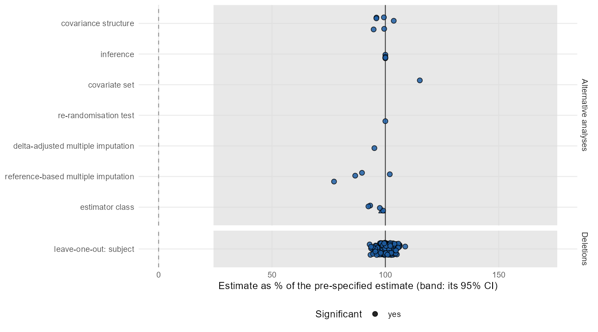
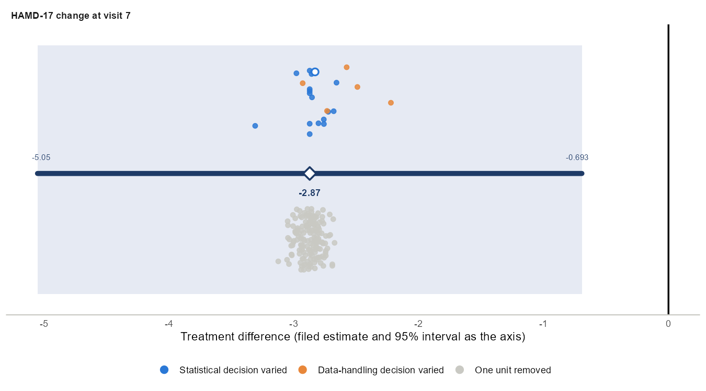
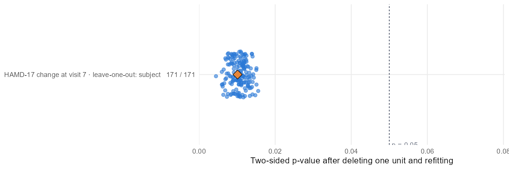
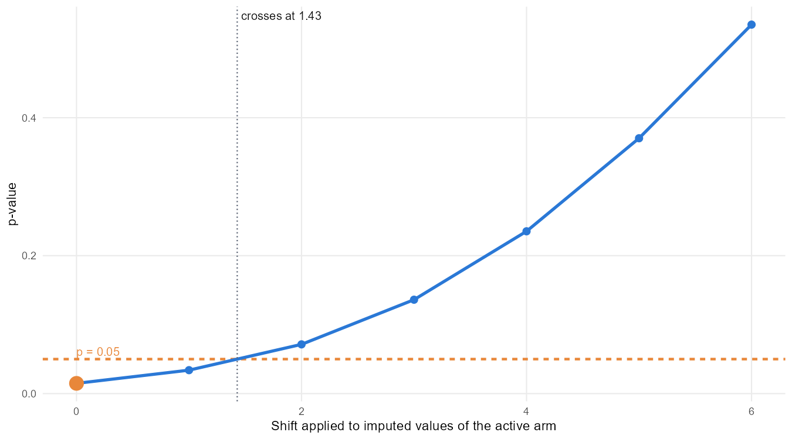

# Standard stress test (ballast 0.7.3)

Generated 2026-10-28 10:52 with ballast 0.7.3.

## Plan

    Standard stress test (ballast 0.7.3)
    
    Pre-specified analysis: CHANGE ~ BASVAL + THERAPY + VISIT + THERAPY:VISIT + us(VISIT | PATIENT); contrast DRUG minus PLACEBO at 7; Satterthwaite df, Asymptotic variance; alpha 0.05; equal LS-mean weights.
    
    Perturbation families, run after unblinding exactly as listed; every refit is judged against the pre-specified estimate,
    its 95% confidence interval and alpha.
    Classification: fragile if any counted alternative lands outside the pre-specified 95% confidence interval; otherwise sensitive if any crosses alpha; otherwise robust.
    Specifications reached by two families are counted once; tipping-point grids are searches and are not counted; deletions are
    counted separately.
    
    1. Within-subject covariance structure: structures = us, ar1h, ar1, cs, csh, toep, toeph
    2. Degrees-of-freedom method and variance estimator: defaults
    3. Covariate set: defaults
    4. Least-squares-mean weighting (equal versus observed margins): defaults
    5. Leave-one-out deletions: defaults
    6. Re-randomisation test: n = 2000
    7. Delta-adjusted multiple imputation (tipping point): deltas = 0, 1, 2, 3, 4, 5, 6; m = 25; shift_visits = 7
    8. Reference-based multiple imputation (MAR, J2R, CR, CIR): m = 25
    9. Estimator class: estimators = complete_cases, gee_independence, ancova, robust_ancova, clda; baseline = BASVAL; diagnostic = complete_cases. The complete cases refit is fitted, drawn and tabulated as a diagnostic and is not counted.
    10. Smallest set of subjects that changes the conclusion: target = significance; max_k = 5

## Pre-specified analysis

Estimate -2.872 (SE 1.1), 95% CI -5.051 to -0.6932, p = 0.0101; 172 subjects, 608 observations.

## Verdict

**ROBUST** over all 193 counted rows; **ROBUST** over the 193 sensitivity analyses (same estimand).
193 significant, 0 crossed alpha, 0 outside the pre-specified CI, 0 reversed direction; largest shift 0.589 pre-specified SEs. 1 diagnostic refit was fitted and shown (counted = FALSE in the family table) and not counted.

Smallest subject set that changes significance: 5 subjects (3913, 4909, 3734, 1811, 3732).

## Summary by family

| family | kind | n | significant | crossed | outside_ci | reversed | pct_min | pct_max | max_shift_se | counted | role |
| --- | --- | --- | --- | --- | --- | --- | --- | --- | --- | --- | --- |
| covariance structure | alternative | 6 | 6 | 0 | 0 | 0 | 94.827 | 103.702 | 0.135 | TRUE | sensitivity |
| inference | alternative | 5 | 5 | 0 | 0 | 0 | 100.000 | 100.000 | 0.000 | TRUE | sensitivity |
| covariate set | alternative | 1 | 1 | 0 | 0 | 0 | 115.196 | 115.196 | 0.396 | TRUE | sensitivity |
| leave-one-out: subject | deletion | 171 | 171 | 0 | 0 | 0 | 93.069 | 108.764 | 0.228 | TRUE | sensitivity |
| re-randomisation test | alternative | 1 | 1 | 0 | 0 | 0 | 100.000 | 100.000 | 0.000 | TRUE | sensitivity |
| delta-adjusted multiple imputation | alternative | 1 | 1 | 0 | 0 | 0 | 95.163 | 95.163 | 0.126 | TRUE | sensitivity |
| reference-based multiple imputation | alternative | 4 | 4 | 0 | 0 | 0 | 77.364 | 101.955 | 0.589 | TRUE | sensitivity |
| estimator class | alternative | 4 | 4 | 0 | 0 | 0 | 92.528 | 99.021 | 0.195 | TRUE | sensitivity |
| estimator class | diagnostic | 1 | 1 | 0 | 0 | 0 | 98.511 | 98.511 | 0.039 | FALSE | sensitivity |
| All sensitivity | all | 193 | 193 | 0 | 0 | 0 | 77.364 | 115.196 | 0.589 | TRUE | sensitivity |
| All | all | 193 | 193 | 0 | 0 | 0 | 77.364 | 115.196 | 0.589 | TRUE | all |

## Figures

## Rows that crossed alpha or left the interval

None.
